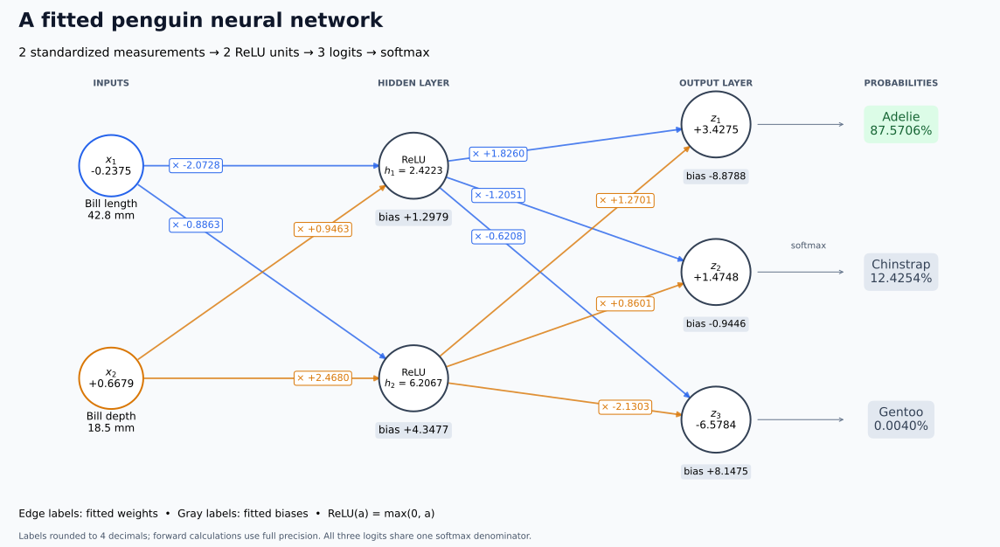

# One penguin, two measurements, three species

The [Palmer Penguins dataset](https://allisonhorst.github.io/palmerpenguins/)
contains measurements of Adelie, Chinstrap, and Gentoo penguins. Our network
uses **bill length** and **bill depth**, both measured in millimeters, to
predict one of these three mutually exclusive species.

The network below was fitted to real observations. Every edge weight and
bias comes from that fit. It has two inputs, two hidden units with ReLU
activation, and three output logits. Its 15 learned parameters comprise
four input-to-hidden weights, two hidden biases, six hidden-to-output
weights, and three output biases.

{#fig-penguin-network width=100% fig-alt="Bill length 42.8 mm and bill depth 18.5 mm become standardized inputs minus 0.2375 and 0.6679. Two ReLU units output 2.4223 and 6.2067. Learned weighted sums and biases produce logits 3.4275, 1.4748, and minus 6.5784 for Adelie, Chinstrap, and Gentoo."}

## Where the weights came from

Of 344 records, 342 have both required measurements. A stratified random
split assigns 256 to training and 86 to testing (split seed 42). Scaling
means and standard deviations are fitted **only on the training rows**.
A scikit-learn `MLPClassifier` with two ReLU hidden units is fitted using
L-BFGS, L2 regularization `alpha=1.0`, initialization seed 7,
`max_iter=3000`, and `tol=1e-9`. The objective combines multiclass
cross-entropy with an L2 weight penalty.

The fitted model correctly classifies **82 of 86 test observations (95.35%)**.
This describes one split and a small model, not a population-level accuracy
claim. The worked observation is held-out CSV record 76 (zero-based index
75), an Adelie with bill length 42.8 mm and bill depth 18.5 mm. It was chosen
to show both hidden units active; it is not a random example of performance.

## Step 1: standardize the measurements

The numbers in this step come from the dataset and preprocessing, before
the neural network computes anything. The **42.8 mm** bill length and
**18.5 mm** bill depth are measurements from the selected held-out penguin.
The means and standard deviations are calculated from the **256 training
penguins only**, without including this penguin or any other test row.

Let $r_{ni}$ be measurement $i$ for training penguin $n$, with $i=1$ for
bill length and $i=2$ for bill depth. For $N=256$ training penguins,

$$
\begin{align}
\begin{aligned}
\mu_i&=\frac{1}{N}\sum_{n=1}^{N}r_{ni},\\
\sigma_i&=\sqrt{\frac{1}{N}\sum_{n=1}^{N}(r_{ni}-\mu_i)^2}.
\end{aligned}
\tag{1}
\end{align}
$$

The standard deviation uses divisor $N$, matching `StandardScaler`
(`ddof=0`), rather than the $N-1$ divisor used for a sample standard
deviation. Both $\mu_i$ and $\sigma_i$ have units of millimeters.
Summing the actual training measurements gives

$$
\begin{align}
\begin{aligned}
\mu_1&=\frac{11292.4}{256}=44.1109375\ \text{mm},\\
\mu_2&=\frac{4387.6}{256}=17.1390625\ \text{mm}.
\end{aligned}
\tag{2}
\end{align}
$$

The sums of squared deviations are $7797.469375\ \text{mm}^2$ for bill
length and $1062.769375\ \text{mm}^2$ for bill depth. Therefore,

$$
\begin{align}
\begin{aligned}
\sigma_1&=\sqrt{\frac{7797.469375}{256}}\approx5.518955041\ \text{mm},\\
\sigma_2&=\sqrt{\frac{1062.769375}{256}}\approx2.037508987\ \text{mm}.
\end{aligned}
\tag{3}
\end{align}
$$

For a new penguin's measurement $r_i$, standardization subtracts the
training mean and divides by the training standard deviation:

$$
\begin{align}
x_i=\frac{r_i-\mu_i}{\sigma_i}.
\tag{4}
\end{align}
$$

Substituting this penguin's measurements gives dimensionless network inputs:

$$
\begin{align}
x_1=\frac{42.8-44.1109375}{5.518955041}\approx-0.237534,
\qquad
x_2=\frac{18.5-17.1390625}{2.037508987}\approx0.667942.
\tag{5}
\end{align}
$$

Raw millimeter values must not be substituted directly into a network
trained on standardized inputs.

Thus $x_1\approx-0.237534$ means the bill length is about **0.238 training
standard deviations below the training mean**. Similarly,
$x_2\approx0.667942$ means the bill depth is about **0.668 training standard
deviations above the training mean**. These are input transformations, not
learned neural-network weights or neural-network predictions. The same
training means and standard deviations are reused for every test or new
penguin; they are not recalculated for each prediction.

## Step 2: apply the learned weights, biases, and ReLU

We use **row vectors**. The first-layer calculation is

$$
\begin{align}
\mathbf a=\mathbf x W^{(1)}+\mathbf b^{(1)},
\qquad \mathbf h=\operatorname{ReLU}(\mathbf a),
\qquad \operatorname{ReLU}(a)=\max(0,a).
\tag{6}
\end{align}
$$

Here $\mathbf x$, $\mathbf a$, $\mathbf h$, and $\mathbf b^{(1)}$ each have
shape $1\times2$, and $W^{(1)}$ has shape $2\times2$. Matrix rows correspond
to source units and columns to destination units. The fitted parameters are

$$
\begin{align}
W^{(1)}\approx
\begin{bmatrix}-2.072764&-0.886296\\0.946348&2.467951\end{bmatrix},
\qquad
\mathbf b^{(1)}\approx(1.297868,4.347731).
\tag{7}
\end{align}
$$

Each hidden unit first adds its weighted inputs and bias, then applies ReLU:

$$
\begin{align}
\begin{aligned}
a_1&=(-0.237534)(-2.072764)+(0.667942)(0.946348)+1.297868
\approx2.422324,\\
a_2&=(-0.237534)(-0.886296)+(0.667942)(2.467951)+4.347731
\approx6.206703,\\
h_1&=\max(0,a_1)=2.422324,\qquad
h_2=\max(0,a_2)=6.206703.
\end{aligned}
\tag{8}
\end{align}
$$

Both pre-activations are positive for this penguin, so ReLU leaves them
unchanged. A negative pre-activation would become zero. Displayed values
are rounded; all subsequent calculations use the saved full-precision values.

## Step 3: compute the three logits

The output layer is a weighted sum plus a bias, with **no ReLU**:

$$
\begin{align}
\mathbf z=\mathbf h W^{(2)}+\mathbf b^{(2)}.
\tag{9}
\end{align}
$$

$W^{(2)}$ has shape $2\times3$; $\mathbf b^{(2)}$ and $\mathbf z$ have
shape $1\times3$. Output columns are ordered Adelie, Chinstrap, Gentoo:

$$
\begin{align}
W^{(2)}\approx
\begin{bmatrix}
1.825970&-1.205052&-0.620818\\
1.270110&0.860100&-2.130284
\end{bmatrix},
\qquad
\mathbf b^{(2)}\approx(-8.878830,-0.944601,8.147451).
\tag{10}
\end{align}
$$

$$
\begin{align}
\begin{aligned}
z_A&=(2.422324)(1.825970)+(6.206703)(1.270110)-8.878830
\approx3.427460,\\
z_C&=(2.422324)(-1.205052)+(6.206703)(0.860100)-0.944601
\approx1.474760,\\
z_G&=(2.422324)(-0.620818)+(6.206703)(-2.130284)+8.147451
\approx-6.578413.
\end{aligned}
\tag{11}
\end{align}
$$

The subscripts $A$, $C$, and $G$ denote Adelie, Chinstrap, and Gentoo.
The diagram labels these same outputs $z_1$, $z_2$, and $z_3$.
These dimensionless raw scores are **logits**, not probabilities.
They can be negative or greater than one.

| Class | Logit | Rank, largest first |
|:--|--:|--:|
| Adelie | 3.427460 | 1 |
| Chinstrap | 1.474760 | 2 |
| Gentoo | -6.578413 | 3 |

Two different questions follow: **Which class has the largest score?** and
**How can we turn all three scores into a probability distribution?**

# Argmax selects the winner

The maximum is the largest **value**. The argmax identifies the **position or
label** at which that value occurs:

$$
\begin{align}
\max_i z_i\approx3.427460, \qquad \hat{y}=\operatorname*{arg\,max}_{i\in\{A,C,G\}} z_i=A.
\tag{12}
\end{align}
$$

The predicted class is Adelie. Its one-hot representation is $(1,0,0)$:
one at the selected class and zero elsewhere. This encoding records a decision;
it does not mean the model has established a 100% probability of Adelie.
Argmax itself returns an index or label, not this three-element vector.
If scores tie, a single-choice implementation needs a tie-breaking rule.

Argmax discards the size of the lead. Scores $(3.427460,1.474760,-6.578413)$ and
$(1.484760,1.474760,-6.578413)$ both select Adelie, even though the second decision has
only a $0.01$ margin over Chinstrap.

# Softmax converts scores into probabilities

For $K$ mutually exclusive classes, softmax assigns class $i$ the value

$$
\begin{align}
p_i=\frac{e^{z_i}}{\sum_{j=1}^{K}e^{z_j}},\qquad i=1,\ldots,K.
\tag{13}
\end{align}
$$

Here $e\approx2.71828$ is the base of the natural exponential. Exponentiating
makes every weight positive. Dividing each weight by their shared total makes
the probabilities sum to one. The denominator includes **every class**.

For our three scores, the shared denominator is

$$
\begin{align}
D=e^{z_A}+e^{z_C}+e^{z_G}
\approx 30.798305+4.369986+0.001390=35.169681.
\tag{14}
\end{align}
$$

| Class | Exponential weight $e^{z_i}$ | Probability $e^{z_i}/D$ | Percentage |
|:--|--:|--:|--:|
| Adelie | 30.798305 | 0.87570612 | 87.5706% |
| Chinstrap | 4.369986 | 0.12425436 | 12.4254% |
| Gentoo | 0.001390 | 0.00003952 | 0.0040% |

The denominator uses all three unrounded exponentials. Displayed values are
rounded only after computation. Gentoo has a small positive probability,
not an exact zero.

```{python}
#| label: fig-penguin-scores-probabilities
#| fig-cap: "The same penguin prediction as raw logits, a one-hot argmax decision, and a softmax probability distribution. Softmax preserves the ranking while retaining probability mass for all three classes."
#| fig-alt: "Three bar charts show logits 3.4275, 1.4748, and minus 6.5784; the one-hot decision 1, 0, 0; and softmax probabilities about 0.8757, 0.1243, and 0.00004 for Adelie, Chinstrap, and Gentoo."
#| fig-width: 10
#| fig-height: 3.3
import numpy as np
import matplotlib.pyplot as plt

import json
from pathlib import Path

model = json.loads(Path("assets/penguins/model.json").read_text())
labels = model["classes"]
x = (np.array(model["example"]["raw"]) - model["mean"]) / model["scale"]
h = np.maximum(0, x @ np.array(model["W1"]) + model["b1"])
z = h @ np.array(model["W2"]) + model["b2"]
weights = np.exp(z - z.max())
p = weights / weights.sum()
decision = np.eye(3)[np.argmax(z)]
fig, axes = plt.subplots(1, 3, figsize=(10, 3.3), layout="constrained")
for ax, values, title in zip(
    axes, [z, decision, p],
    ["Raw logits", "One-hot argmax decision", "Softmax probabilities"]
):
    ax.bar(labels, values, color=["#2563eb", "#64748b", "#0f766e"])
    ax.axhline(0, color="#333333", linewidth=0.7)
    ax.set_title(title, fontsize=11)
    ax.tick_params(axis="x", labelsize=8)
    ax.spines[["top", "right"]].set_visible(False)
    for i, value in enumerate(values):
        ax.text(i, value + (0.04 if value >= 0 else -0.05),
                f"{value:.5f}", ha="center",
                va="bottom" if value >= 0 else "top", fontsize=9)
axes[0].set_ylim(-8, 5)
axes[0].set_ylabel("Score")
for ax in axes[1:]:
    ax.set_ylim(0, 1.2)
axes[1].set_ylabel("Selected class indicator")
axes[2].set_ylabel("Probability")
plt.show()
```

Softmax preserves order because the exponential is increasing and all classes
share the same positive denominator. Thus argmax applied to the logits and
argmax applied to their softmax probabilities select the same class, subject
to the same tie rule.

A softmax value is a **model probability**, not a guarantee of correctness.
For a calibrated model, among many predictions assigned about 88% probability,
the corresponding event occurs about 88% of the time. Normalizing scores alone
does not establish calibration; it must be checked against observed outcomes.

# Why training needs more than a hard choice

Hold the Chinstrap score at $1.474760$ and the Gentoo score at $-6.578413$,
while varying the Adelie score $z_A$. Adelie's one-hot decision is zero below
$1.474760$ and one above $1.474760$. At the boundary Adelie and Chinstrap tie.

The indicator is constant on either side: its derivative is zero there and
undefined at the jump. Consequently, ordinary backpropagation through this
hard decision provides no useful gradient for adjusting the scores.

Softmax changes smoothly. Increasing $z_A$ increases $p_A$; increasing a
competing score decreases $p_A$. A differentiable loss can use these changes
to update the network's weights and biases.

For this penguin, whose true class is Adelie, cross-entropy loss is

$$
\begin{align}
L=-\log p_A\approx-\log(0.875706)=0.132725.
\tag{15}
\end{align}
$$

With natural logarithms and target vector $\mathbf{y}=(1,0,0)$, the gradient
with respect to each logit is

$$
\begin{align}
\frac{\partial L}{\partial z_i}=p_i-y_i,
\qquad \nabla_{\mathbf z}L\approx(-0.124294,0.124254,0.000040).
\tag{16}
\end{align}
$$

Gradient descent subtracts the gradient. If we adjusted these logits directly,
this would raise the Adelie score and lower its competitors. In a neural
network, backpropagation carries these gradients to the parameters that
produce the logits. Training libraries often combine softmax and
cross-entropy in a numerically stable operation that accepts logits directly.

# Compute it in Python

Subtracting the largest logit before exponentiating avoids overflow without
changing the probabilities: the common factor cancels from numerator and
denominator.

$$
\begin{align}
\frac{e^{z_i-m}}{\sum_j e^{z_j-m}}
=\frac{e^{-m}e^{z_i}}{e^{-m}\sum_j e^{z_j}}
=p_i,\qquad m=\max_j z_j.
\tag{17}
\end{align}
$$

```{python}
#| echo: true
import json
from pathlib import Path
import numpy as np

model = json.loads(Path("assets/penguins/model.json").read_text())
labels = model["classes"]
raw = np.array([42.8, 18.5])  # Bill length and depth, in mm.
x = (raw - model["mean"]) / model["scale"]
h = np.maximum(0, x @ np.array(model["W1"]) + model["b1"])
z = h @ np.array(model["W2"]) + model["b2"]
winner = int(np.argmax(z))  # NumPy uses zero-based indices.
shifted = z - np.max(z)
probabilities = np.exp(shifted) / np.exp(shifted).sum()
print("Standardized inputs:", np.round(x, 6))
print("Hidden activations:", np.round(h, 6))
print("Logits:", np.round(z, 6))
print("Winning index:", winner)
print("Predicted species:", labels[winner])
print("Probabilities:", np.round(probabilities, 6))
print("Probability sum:", round(float(probabilities.sum()), 6))
```

# From penguin species to next tokens

For a penguin classifier, the candidates are species. For a language model,
the candidates are tokens in its vocabulary. Softmax converts their logits
into a distribution conditional on the current text.

**Greedy decoding** selects the highest-probability token with argmax.
**Sampling** draws a token from the distribution, so a lower-probability token
can also be selected. Softmax computes probabilities; it does not itself draw
a sample or choose a token. See also
[Probability and Text Generation](probability-and-text-generation.qmd).

# Optional extension: derive the softmax gradients

Let $D=e^{z_A}+e^{z_C}+e^{z_G}$, so $p_A=e^{z_A}/D$.
For functions $u$ and $v$, the quotient rule is
$(u/v)'=(u'v-uv')/v^2$. All derivatives below treat the other logits as fixed.

## Change the Adelie score

Both numerator and denominator depend on $z_A$. Their derivatives with
respect to $z_A$ are both $e^{z_A}$, giving

$$
\begin{align}
\begin{aligned}
\frac{\partial p_A}{\partial z_A}
&=\frac{e^{z_A}D-e^{z_A}e^{z_A}}{D^2}\\
&=\frac{e^{z_A}}{D}\left(1-\frac{e^{z_A}}{D}\right)\\
&=p_A(1-p_A)\approx0.108845.
\end{aligned}
\tag{18}
\end{align}
$$

Locally, increasing the Adelie logit by $0.01$ increases its probability by
approximately $0.108845\times0.01=0.001088$, or 0.1088 percentage points.
This is a local approximation, not a constant slope for all score changes.

## Change a competing score

When differentiating with respect to $z_C$, the numerator $e^{z_A}$ has
derivative zero and the denominator has derivative $e^{z_C}$:

$$
\begin{align}
\begin{aligned}
\frac{\partial p_A}{\partial z_C}
&=\frac{0\cdot D-e^{z_A}e^{z_C}}{D^2}\\
&=-\frac{e^{z_A}}{D}\frac{e^{z_C}}{D}
=-p_Ap_C\approx-0.108810.
\end{aligned}
\tag{19}
\end{align}
$$

Similarly,

$$
\begin{align}
\frac{\partial p_A}{\partial z_G}=-p_Ap_G\approx-0.000035.
\tag{20}
\end{align}
$$

The negative signs express competition for a fixed total probability of one.
In general, the $K\times K$ Jacobian has entries

$$
\begin{align}
\frac{\partial p_i}{\partial z_j}
=\begin{cases}
p_i(1-p_i), & i=j,\\
-p_ip_j, & i\ne j.
\end{cases}
\tag{21}
\end{align}
$$

Combining this result with $L=-\log p_A$ gives
$\partial L/\partial z_A=p_A-1$ and
$\partial L/\partial z_j=p_j$ for competing classes, the gradient used above.

# Check your understanding

1. What changes if you add 10 to every logit: the argmax, the softmax
   probabilities, both, or neither?
2. If all three logits are equal, what are their softmax probabilities?
3. Why is $(1,0,0)$ a different kind of output from $(0.875706,0.124254,0.000040)$?
4. What is the sign of $\partial p_A/\partial z_G$, and what does it mean?

::: {.callout-note collapse="true" title="Answers"}
1. Neither changes. Rankings are unchanged, and the common exponential factor
   cancels in softmax.
2. Each probability is $1/3$. A single argmax choice requires a tie rule.
3. The first encodes a selected class; the second allocates probability mass
   across all classes.
4. Negative: increasing Gentoo's score decreases Adelie's probability
   when the other scores are fixed.
:::

# Data and reproducibility

Data: Horst, Hill, and Gorman's [Palmer Penguins](https://allisonhorst.github.io/palmerpenguins/),
shared under CC0. The [local CSV](assets/penguins/penguins.csv) is a saved
copy of the package's public data. The [model record](assets/penguins/model.json)
contains its SHA-256 checksum, exact split indices, software versions,
scaling statistics, full-precision fitted parameters, and worked outputs.

From the repository root, regenerate the fitted model and network image with:

```bash
python scripts/build_penguin_softmax_example.py
```

The saved fit uses scikit-learn 1.7.0. Numerical optimization can vary slightly
across software versions; the saved model record fixes the values used here.
The [training and diagram script](../../scripts/build_penguin_softmax_example.py)
checks the manual forward pass against the classifier on every held-out row
and checks softmax derivatives using finite differences.

The progression from logits to argmax, softmax, and derivatives follows the
supplied Josh Starmer StatQuest examples. This penguin model is fitted
independently; its weights, biases, and outputs are not taken from the iris example.
